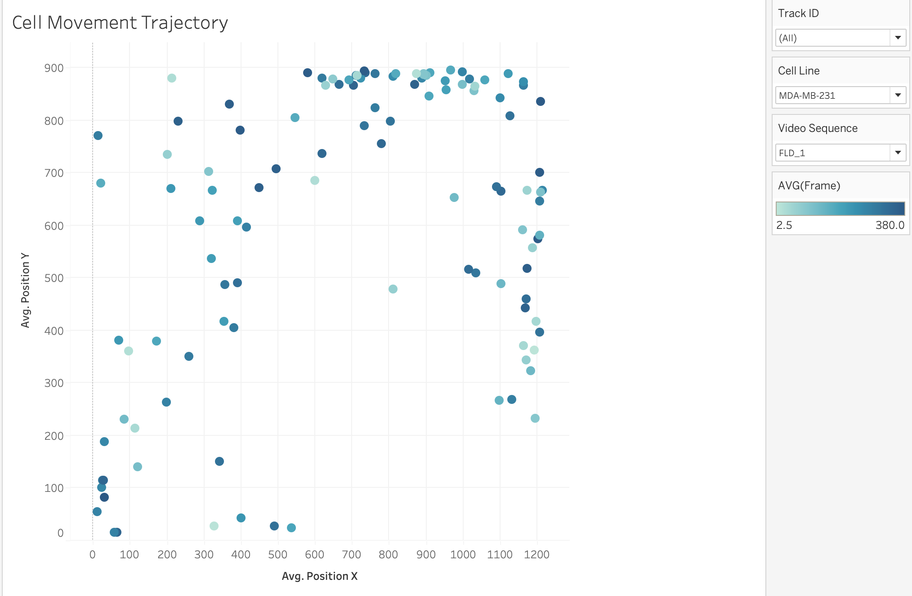
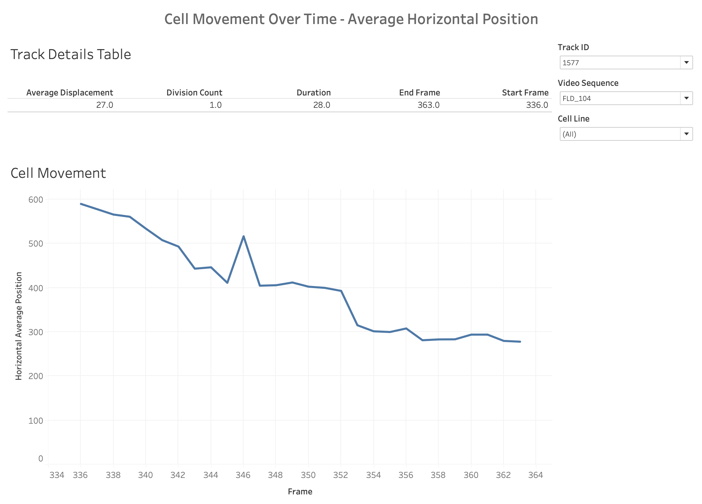
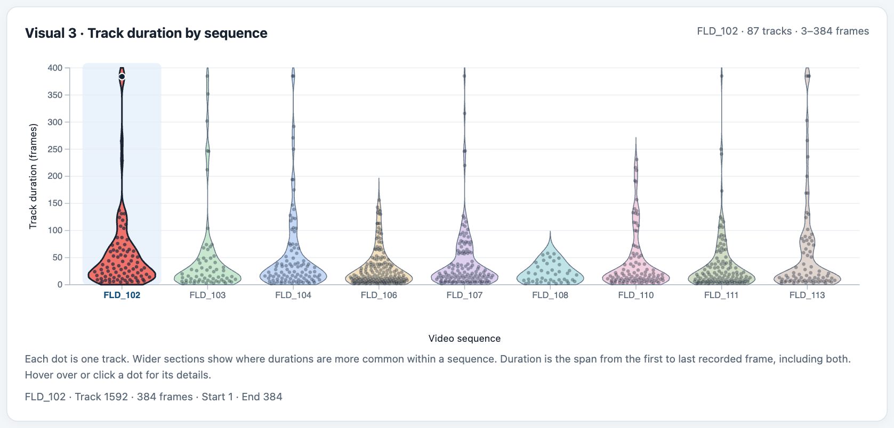

# Visual 3 Process Book — Track Duration by Sequence

## The question

Use Case 1 asks biologists to explore ground-truth cell tracks and investigate unusual behavior. For Visual 3, I focused on two questions: How long were the cells tracked in each video sequence, and which tracks were unusually short or long? Duration gives this view a distinct role in the dashboard. Visual 3 shows how long individual tracks were recorded and how those durations vary across videos of the same cell line.

## From movement to duration

The first trajectory design plotted horizontal and vertical position and used color to represent frame number. The shape made it possible to trace where a single cell moved. Following the order of observations took more effort because the reader had to interpret the color scale, especially where points overlapped and didn't show what was needed for the dashboard.

*Figure 1. The trajectory alternative from the project prototype. The path through space is visible, while the order of observations depends on color.*

The next prototype put frame number on the horizontal axis and horizontal position on the vertical axis. A details table gave the frame range and other attributes for the selected track. This made change over time easier to see. To compare durations across multiple tracks, a viewer would still have needed to select tracks one at a time and remember the values in the table.

*Figure 2. The project prototype’s line chart and details table for one selected track.*

## The duration view

I used a violin for each sequence and kept one dot per track. Vertical position shows duration in frames. Wider parts of a violin show where similar durations are more common within that sequence. Each shape is scaled to its own peak. Smoothing can extend the outline beyond the outermost dots, so the selected sequence’s summary reports the actual track count and observed duration range. A shared vertical scale within the current cell line makes it possible to compare durations by height.

The chart uses the repository’s ground-truth dataset, which has 229,890 observation rows across 25 sequences and four cell lines. I grouped valid records by track ID within each sequence and calculated duration as last recorded frame − first recorded frame + 1. This measures the inclusive frame span. If there is a gap in the observations, the span still includes the intervening frames. A track reaching the beginning or end of a recording may extend beyond the video.

I tried adding a median line to each violin and removed it after reviewing the result. The final chart uses the shape and dots to show the distribution. A shaded background, stronger fill, and bold label identify the selected sequence while the other sequences stay visible for comparison. The shared Cell track and Sequence controls keep the heatmap and violin plot in sync. Hovering previews a dot’s track ID, duration, and frame endpoints. Clicking keeps those details visible and selects the dot’s sequence.

*Figure 3. The final chart preserves the comparison across all nine MCF10A sequences while highlighting FLD_102 and showing details for Track 1592.*

## What the chart reveals

In MCF10A, **FLD_102 has 87 tracks spanning 3–384 frames**, while **FLD_108 has 42 tracks spanning 2–58 frames**. Showing both on one scale makes the difference in their upper ranges easy to spot. The dots also show how sparse the long-duration tail is in FLD_102. Only five of its 87 tracks last 200 frames or longer. Clicking one of the highest dots identifies Track 1592, which spans frames 1–384. That takes a reader from a sequence-level pattern to a specific record they can investigate.

 [Visual 3 implementation](../js/visualizations/visualization3.js)
